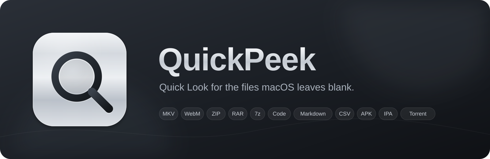
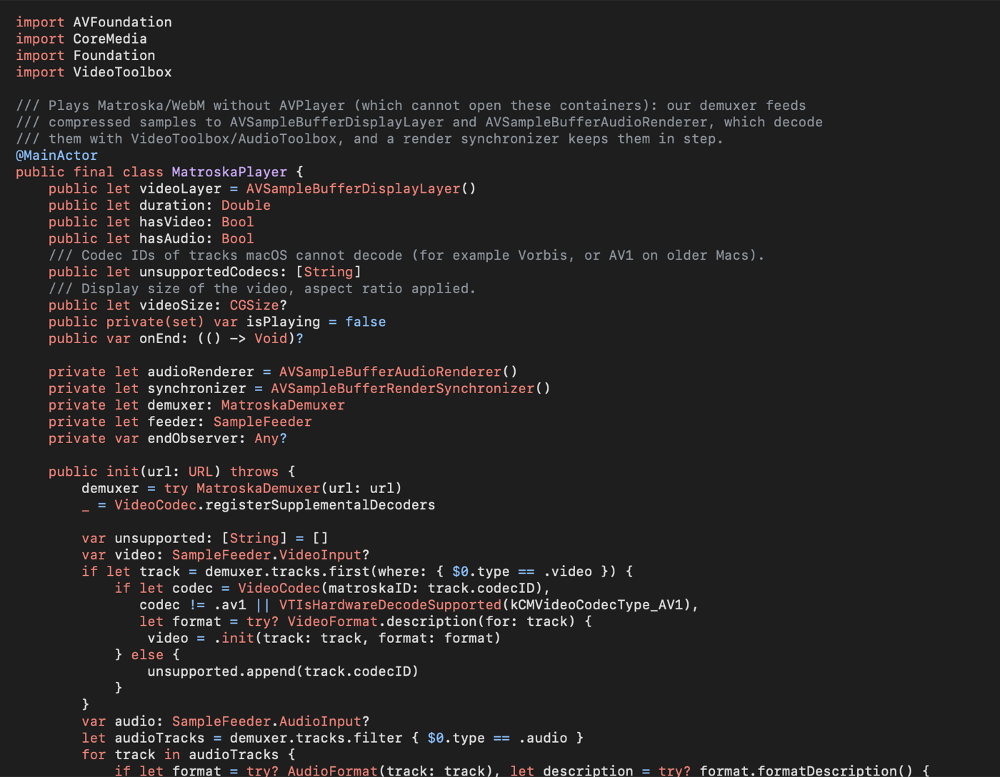
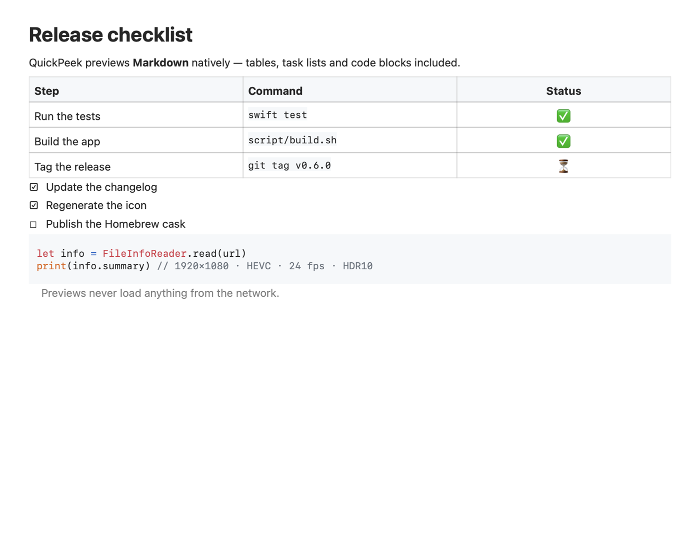
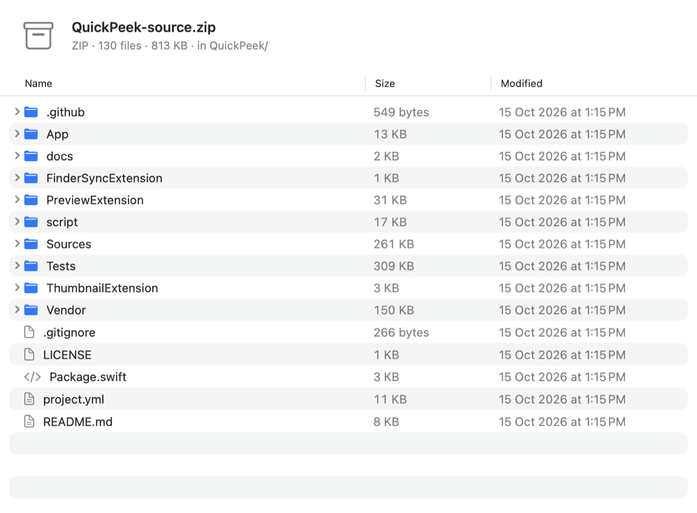
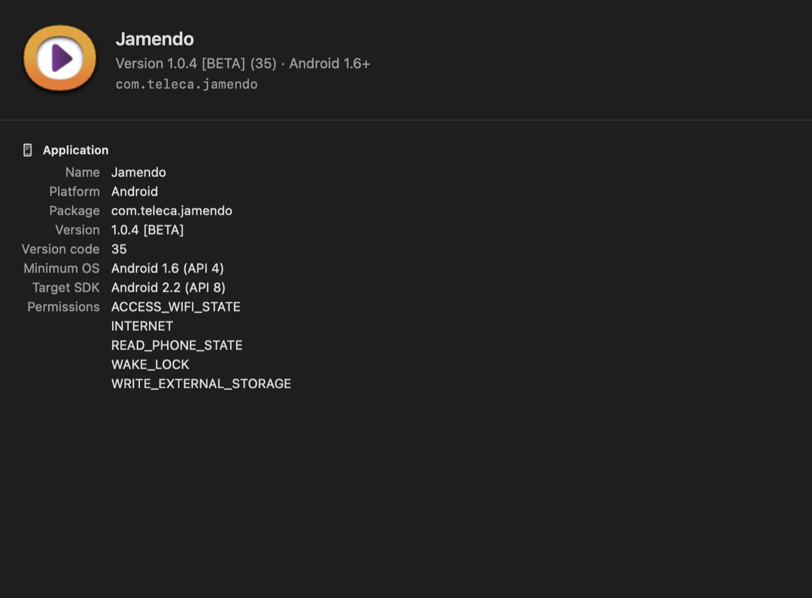
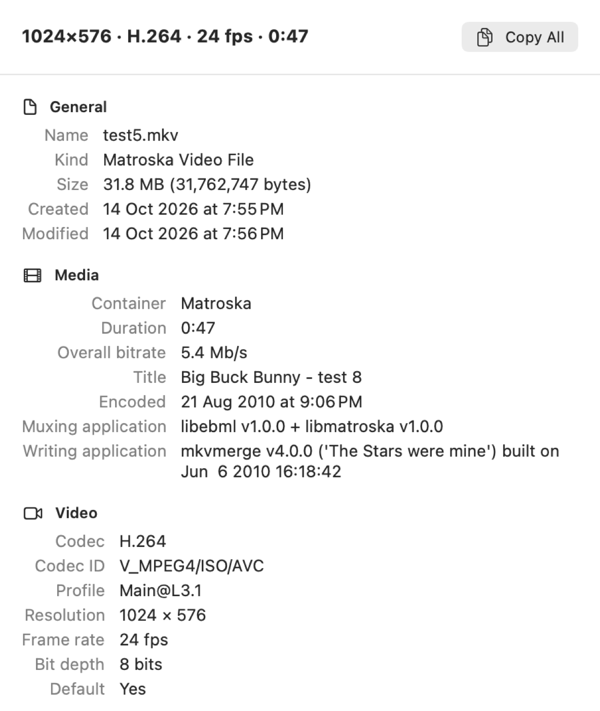

<p align="center">
  
</p>

<p align="center">
  <a href="https://github.com/yinon-mitin/QuickPeek/actions/workflows/ci.yml"></a>
  <a href="https://github.com/yinon-mitin/QuickPeek/releases"></a>
  <a href="LICENSE"></a>
  
</p>

<p align="center"><strong>One small native app that fills the gaps in Quick Look.</strong><br>
Press Space on MKV videos, archives, source code, Markdown, Android and iOS apps, torrents and more.<br>
Free and open source, under 4 MB, no ffmpeg, no web views.</p>

## Screenshots

<p align="center">
  
  
  
  
  
  
</p>

## What it previews

| Files | What you see |
|-------|--------------|
| **Video** — MKV, WebM, MKA | A native player with hardware decoding (H.264, HEVC, VP9, AV1\*; AAC, Opus, FLAC, AC-3, E-AC-3, MP3) and Finder thumbnails |
| **Archives** — ZIP, RAR, 7z, TAR (gz, bz2, xz), ISO, CPIO, XAR, CAB, LHA | The file tree with sizes and dates, without extracting anything |
| **Code and config** — YAML, JSON, TOML, Swift, Python, Go, Rust, Shell, Dockerfile, ~50 more | Syntax highlighting in light and dark mode |
| **Markdown** | Rendered text with tables, task lists and highlighted code blocks |
| **Tables** — CSV, TSV | A real table; the delimiter is detected |
| **Apps** — IPA, APK, Xcode archives | Icon (also as the Finder thumbnail), version, identifier, minimum OS, permissions, provisioning profile |
| **Torrents** | Files, size, info hash, trackers, and a button that copies the magnet link |

\* AV1 needs a Mac with an AV1 decoder (M3 or later). Codecs macOS cannot decode (Vorbis, Theora, WMV) are named instead of played.

Word, Excel, PowerPoint, PDF, RAW photos, HEIC, WebP and ICO already have good previews in macOS, so QuickPeek leaves them to the system.

## File details

Right-click any file in Finder: the menu shows a one-line summary, such as
`3840×2160 · HEVC · 23.976 fps · HDR10 · 1:42:05`, with the full details in its submenu.
Choose a line to copy its value. The ⓘ button in QuickPeek's previews shows the same details.

It covers video and audio (codecs, profiles, bitrate, HDR, channels, languages), photos and RAW (camera, lens, exposure, GPS), documents (PDF and Office properties, fonts, text encoding), archives, torrents and apps (architectures, code signature).

## Install

### Homebrew

```sh
brew install --cask yinon-mitin/tap/quickpeek
brew upgrade --cask quickpeek      # later, to update
```

### Download

Download `QuickPeek-<version>.zip` from [Releases](https://github.com/yinon-mitin/QuickPeek/releases), unzip it and move `QuickPeek.app` to `/Applications`.

### First launch

QuickPeek is signed ad hoc rather than notarized by Apple, so macOS asks once:

1. Open `QuickPeek.app`. macOS says it cannot verify the developer.
2. Open **System Settings → Privacy & Security** and click **Open Anyway** next to QuickPeek.
3. Open QuickPeek again. This registers its Quick Look, thumbnail and Finder extensions.

If previews do not appear, check **System Settings → General → Login Items & Extensions**: turn on QuickPeek under **Quick Look** and **Finder**, and turn off older plugins for the same files.

### Build from source

Requires macOS 26 and Xcode 26.

```sh
brew install xcodegen
git clone https://github.com/yinon-mitin/QuickPeek.git
cd QuickPeek
script/build.sh      # runs the tests and builds build/QuickPeek.app
script/install.sh    # copies it to /Applications and enables the extensions
```

## Privacy

The extensions run in the App Sandbox with read-only access to the file you preview. They have no network access, and nothing a file references (remote images, links) is ever loaded.

## Contributing

Bug reports and pull requests are welcome. [CONTRIBUTING.md](CONTRIBUTING.md) describes the project layout, the tests and the debugging tools; [CHANGELOG.md](CHANGELOG.md) lists what changed in each version.

## License

MIT — see [LICENSE](LICENSE). QuickPeek bundles [highlight.js](https://highlightjs.org) (BSD-3-Clause) and reads archives with the libarchive that ships with macOS. The video screenshot is from *Elephants Dream* © Blender Foundation, CC BY 2.5.
